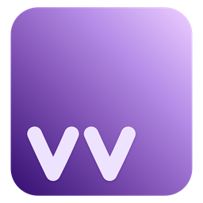

<div align="center">
  
  <h1>VoicierVoice</h1>
  <p>
    <strong>面向 Windows 的超低延迟实时声纹降噪与目标人声提取桌面应用</strong><br />
    Real-Time Voiceprint Isolation &amp; Target-Speaker Denoising for Windows (WPF / Fluent 2 / ONNX)
  </p>
</div>

---

## 简介 | Introduction

**VoicierVoice** 是一款基于 **[VoxLock](https://github.com/arbazsiddiqui/voxlock)** 的 Windows 10 / 11 实时个人声纹提取与语音降噪桌面应用。通过串联 **Silero VAD（语音活动检测） → GTCRN（前置流式降噪） → VoxLock（目标人声锁相提取）** 三级级联神经网络管线，只需录制 5 秒个人人声样本，即可在实时通话、游戏开黑或直播场景中精准保留你的声音，同时消除键盘敲击、风扇底噪以及周围旁人交谈干扰。

### 核心特性
- **三级级联实时 AI 管线**：
  1. **Silero VAD**：实时检测语音活动，无人说话时自动进入静音休眠并旁路下游推理，实现静音时段零算力消耗。
  2. **GTCRN**：超轻量级流式语音增强模型，先一步消除稳态底噪与高频环境杂音。
  3. **VoxLock**：基于个人 5 秒参考声纹作为锁相条件，从混合人声中精准分离目标说话人，支持 `INT8`、`INT8 Full`、`FP16` 精度变体。
- **低延迟稳定 WASAPI 音频流**：采用定时器轮询模式 WASAPI Capture/Render、起播预缓冲水位线与跨边界 64 采样点软过渡防爆音保护，并自动识别 **VB-Cable**、**VoiceMeeter** 等虚拟声卡端点。
- **算力后端与混合架构核心调度**：支持 **CPU 单线程锁核**（在大小核 CPU 上自动绑定 `E-Core` 能效核或尾部物理核，避免与 3D 游戏争抢主核/显卡）以及 **NVIDIA CUDA GPU** 加速。
- **Fluent 2 现代化界面**：支持浅色 / 深色 / 跟随系统主题（同步 Win11 DWM Mica / 标题栏）、中英双语即时切换以及最小化到系统托盘后台运行。

---

## 依赖与技术栈 | Dependencies & Acknowledgements

### 1. 核心算法与神经网络模型
- **[VoxLock](https://github.com/arbazsiddiqui/voxlock)**（核心声纹提取引擎）  
  目标人声锁相提取与声纹特征嵌入核心（模型权重源自 [`arbazsiddiqui/voxlock`](https://huggingface.co/arbazsiddiqui/voxlock)：`enroll.onnx`、`enroll_fp16.onnx`、`chunk_int8.onnx`、`chunk_int8_full.onnx`、`chunk_fp16.onnx`）。
- **[Silero VAD](https://github.com/snakers4/silero-vad)**  
  高精度低延迟语音活动检测模型（`silero_vad.onnx`）。
- **[GTCRN](https://github.com/Xiaobin-Rong/gtcrn)** / **[sherpa-onnx](https://github.com/k2-fsa/sherpa-onnx)**  
  超轻量级流式语音增强降噪模型（`gtcrn_simple.onnx`）。

### 2. 运行时与开源库
| 组件 / NuGet 包 | 版本 | 用途 | 开源仓库 |
| :--- | :--- | :--- | :--- |
| **.NET Desktop / WPF** | `.NET 10.0` (`net10.0-windows`) | Windows 桌面 UI 与系统集成 | [dotnet/wpf](https://github.com/dotnet/wpf) |
| **Microsoft.ML.OnnxRuntime.Gpu** | `1.17.1` | CPU & CUDA ONNX 模型推理引擎 | [microsoft/onnxruntime](https://github.com/microsoft/onnxruntime) |
| **NAudio** | `2.3.0` | Windows WASAPI 音频采集、重采样与渲染 | [naudio/NAudio](https://github.com/naudio/NAudio) |
| **CommunityToolkit.Mvvm** | `8.4.2` | 现代化 MVVM 绑定与异步命令支持 | [CommunityToolkit/dotnet](https://github.com/CommunityToolkit/dotnet) |

### 3. 环境要求
- **操作系统**：Windows 10 / Windows 11（64 位 x64）
- **虚拟声卡**（用于在 Discord / 腾讯会议 / OBS / 游戏等软件中接入处理后的声音）：推荐安装 [VB-Audio Virtual Cable](https://vb-audio.com/Cable/) 或 [VoiceMeeter](https://vb-audio.com/Voicemeeter/)
- **可选 GPU 加速**：支持 CUDA 的 NVIDIA 显卡与对应 CUDA / cuDNN 运行环境（无 CUDA 环境会自动回退至 CPU 单线程模式）

---

## 使用说明 | Usage Guide

### 1. 准备工作：配置虚拟声卡（可选但推荐）
如果你希望将降噪后的纯净人声输出给通话软件、会议或游戏内语音：
1. 安装虚拟声卡驱动（如 **VB-Cable** 或 **VoiceMeeter**）。
2. 在 VoicierVoice 中输出设备选择虚拟声卡输入端（如 `CABLE Input` 或 `VoiceMeeter Input`）。
3. 在你的通话/录制软件中，将麦克风输入设备设置为对应的虚拟声卡输出端（如 `CABLE Output` 或 `VoiceMeeter Out`）。

> 提示：向虚拟声卡输出时，建议保持「实时监听自己声音」关闭，以免听到自己的延迟回声。

### 2. 三步开启实时声纹提取
1. **选择设备**：打开 **主页**，选择你的物理输入麦克风与输出设备（虚拟声卡或监听设备）。
2. **录制声纹**：切换到 **声纹** 页面，在安静环境下距麦克风 20–30 cm 点击「录制我的声纹」，清晰朗读引导文本 5 秒以生成离线声纹缓存（保存于 `%LocalAppData%\VoicierVoice`）。
3. **开启降噪**：点击右上角 **实时声纹提取** 主开关。顶部状态颜文字会随状态动态变化：
   - `( • vv • )`：已待机 / 未开启
   - `d( • vv • )b`：管线已开启，静音休眠省电中
   - `d( ^ ∀ ^ )b`：正在实时过滤并提取目标人声

### 3. 算力与外观设置
- **CPU&GPU**：游戏开黑时推荐选择 **CPU 单线程锁核** 并开启 **自动绑定能效核**；切换至 `FP16` 精度或需要释放 CPU 时可启用 **CUDA GPU 加速**。
- **其他设置**：支持即时切换 **跟随系统 / 浅色 / 深色** 主题、**简体中文 / English** 双语界面以及 **关闭窗口时最小化到系统托盘**。

---

## 从源码构建 | Build from Source

```powershell
# 1. 克隆仓库
git clone <your-repo-url> VoicierVoice
cd VoicierVoice

# 2. （如需重新下载并校验 ONNX 模型与 model_manifest.json）
python scripts/prepare_models.py

# 3. 编译 Release 版本
dotnet build VoicierVoice.csproj -c Release

# 4. 运行内置无头自检（模型清单、拓扑、推理性能、UI 冒烟测试）
.\bin\Release\net10.0-windows\VoicierVoice.exe --self-test

# 5. 启动应用
dotnet run --project VoicierVoice.csproj -c Release
```

---

## 致谢 | Acknowledgements

特别感谢以下核心项目与社区贡献者的开源成果：
- **[arbazsiddiqui/voxlock](https://github.com/arbazsiddiqui/voxlock)**：提供核心目标说话人锁相提取与声纹模型能力
- **[snakers4/silero-vad](https://github.com/snakers4/silero-vad)**：Silero VAD 实时语音活动检测
- **[Xiaobin-Rong/gtcrn](https://github.com/Xiaobin-Rong/gtcrn)** & **[k2-fsa/sherpa-onnx](https://github.com/k2-fsa/sherpa-onnx)**：GTCRN 轻量流式语音增强模型
- **[NAudio](https://github.com/naudio/NAudio)**, **[ONNX Runtime](https://github.com/microsoft/onnxruntime)**, **[CommunityToolkit](https://github.com/CommunityToolkit/dotnet)**

---

## 许可证 | License

本项目基于 [Apache License 2.0](LICENSE) 开源协议发布。详情请参见仓库根目录的 [LICENSE](LICENSE) 文件。
