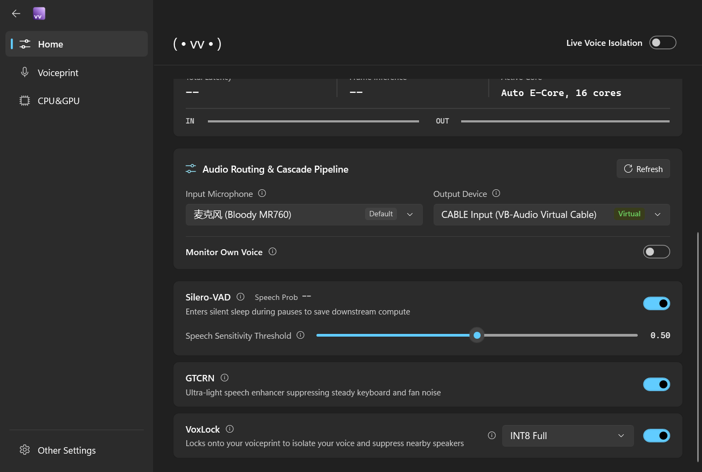
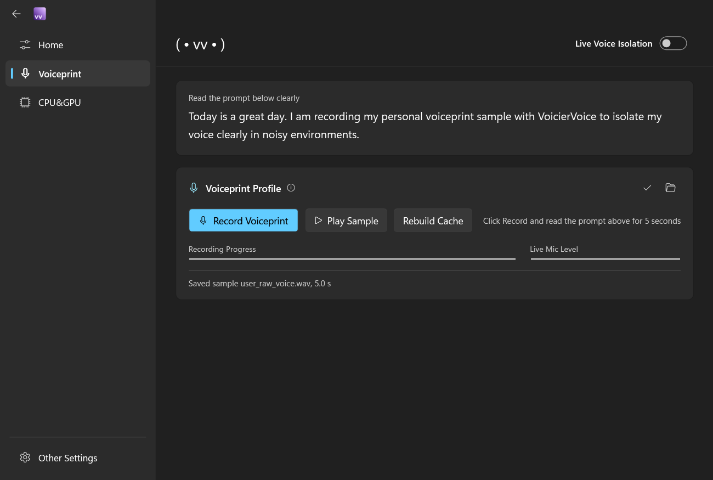
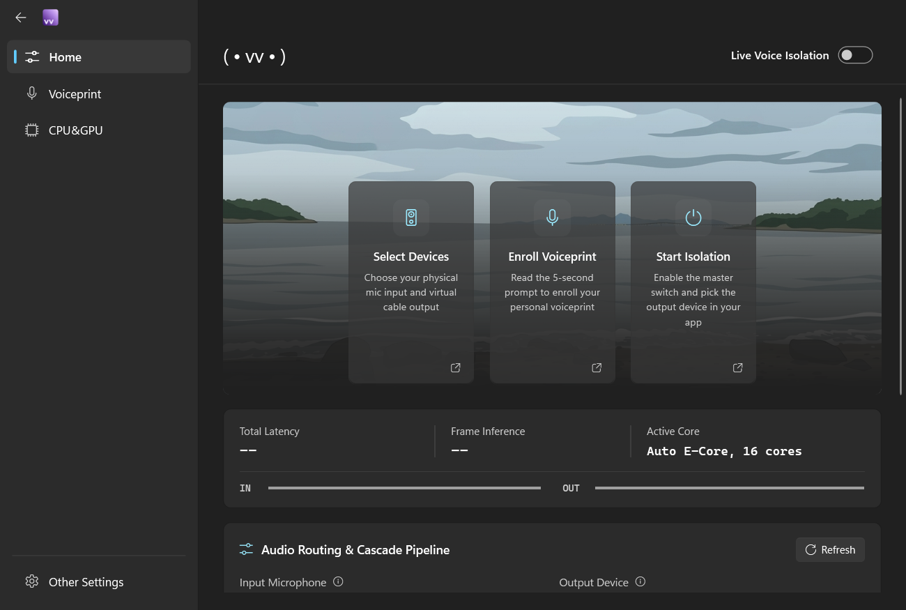
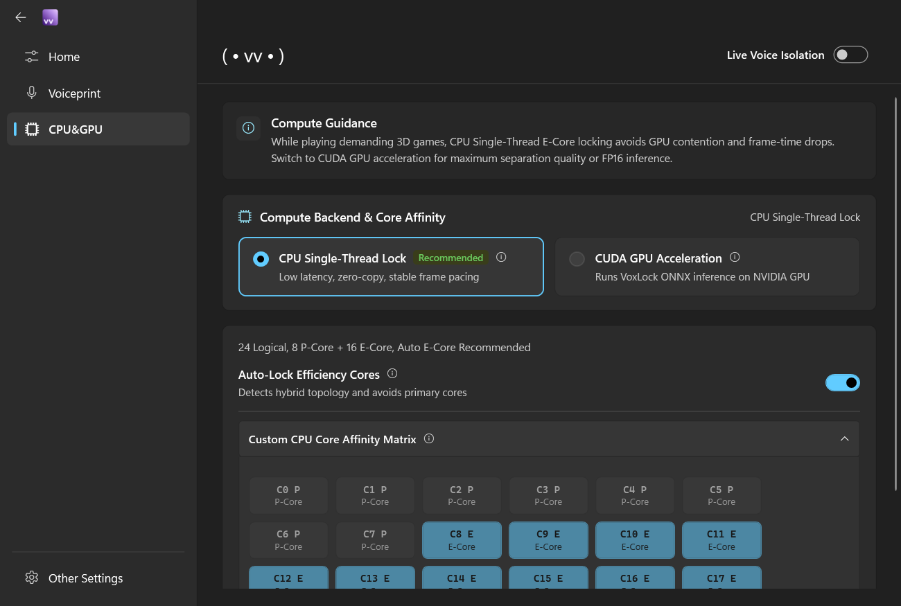

<div align="center">
  
  <h1>VoicierVoice</h1>
  <p>
    <strong>Real-Time Voiceprint Isolation and Denoising Desktop Application for Windows</strong><br />
    <a href="README.md">简体中文</a> | English
  </p>
</div>

> **Prerequisite**: To route processed voice output as a microphone into third-party voice, meeting, or streaming applications (such as Discord, Teams, Zoom, or OBS), VoicierVoice **depends on a virtual audio driver** such as [VB-Audio Virtual Cable](https://vb-audio.com/Cable/) or [VoiceMeeter](https://vb-audio.com/Voicemeeter/). Install a virtual audio device before routing audio between applications.

---

## Overview

**VoicierVoice** is a Windows 10 / 11 desktop application built on **[VoxLock](https://github.com/arbazsiddiqui/voxlock)** for real-time personal voiceprint isolation and speech denoising. By chaining Silero VAD, GTCRN, and VoxLock using a 5-second local voice sample, it isolates the enrolled speaker's voice while suppressing background noise and nearby speech.

### Features
- **Processing Pipeline**: Processes 16 kHz mono audio frames sequentially through three ONNX stages:
  1. **Silero VAD**: Real-time voice activity detection (32 ms / 512 samples). Enters idle sleep and bypasses downstream inference when speech probability drops below threshold.
  2. **GTCRN**: Streaming speech enhancement model (16 ms / 256 samples) for suppressing stationary background noise.
  3. **VoxLock**: Target-speaker extraction conditioned on a local 5-second voiceprint embedding, supporting `INT8`, `INT8 Full`, and `FP16` model variants.
- **WASAPI Audio Stream**: Uses timer-driven polling mode WASAPI Capture (25 ms) and WASAPI Render (45 ms), persistent streaming resamplers, a 54 ms output pre-buffer watermark, and a 64-sample linear crossfade on underrun/resume. Virtual audio endpoints such as VB-Cable and VoiceMeeter are automatically detected.
- **Compute Backend & Core Affinity**: Supports CPU single-thread affinity locking and NVIDIA CUDA GPU acceleration. Automatically detects hybrid P-Core / E-Core topology and binds audio worker threads to efficiency cores (or tail cores on homogeneous CPUs), with optional manual core selection.
- **Fluent 2 UI**: Supports System / Light / Dark themes synced with Windows 11 DWM Mica and caption bars, runtime Simplified Chinese / English switching, launch on Windows startup, and minimize-to-tray background operation.

---

## Dependencies & Acknowledgements

### 1. Virtual Audio Driver & Neural Models
- **Virtual Audio Driver (Required for inter-app audio routing)**: [VB-Audio Virtual Cable](https://vb-audio.com/Cable/) or [VoiceMeeter](https://vb-audio.com/Voicemeeter/)
- **[VoxLock](https://github.com/arbazsiddiqui/voxlock)**: Core target-speaker extraction and voiceprint enrollment model (model weights from [`arbazsiddiqui/voxlock`](https://huggingface.co/arbazsiddiqui/voxlock): `enroll.onnx`, `enroll_fp16.onnx`, `chunk_int8.onnx`, `chunk_int8_full.onnx`, `chunk_fp16.onnx`).
- **[Silero VAD](https://github.com/snakers4/silero-vad)**: Voice activity detection model (`silero_vad.onnx`).
- **[GTCRN](https://github.com/Xiaobin-Rong/gtcrn)** / **[sherpa-onnx](https://github.com/k2-fsa/sherpa-onnx)**: Streaming speech enhancement model (`gtcrn_simple.onnx`).

### 2. Runtime & Open-Source Libraries
| Component / NuGet Package | Version | Purpose | Repository |
| :--- | :--- | :--- | :--- |
| **.NET Desktop / WPF** | `.NET 10.0` (`net10.0-windows`) | Windows desktop UI and shell integration | [dotnet/wpf](https://github.com/dotnet/wpf) |
| **Microsoft.ML.OnnxRuntime.Gpu** | `1.17.1` | CPU & CUDA ONNX inference runtime | [microsoft/onnxruntime](https://github.com/microsoft/onnxruntime) |
| **NAudio** | `2.3.0` | WASAPI audio capture, resampling, and render | [naudio/NAudio](https://github.com/naudio/NAudio) |
| **CommunityToolkit.Mvvm** | `8.4.2` | MVVM observable properties and commands | [CommunityToolkit/dotnet](https://github.com/CommunityToolkit/dotnet) |

### 3. System Requirements
- **OS**: Windows 10 / Windows 11 (64-bit)
- **Self-Contained Releases**: Pre-built GitHub Release archives bundle the .NET 10 Desktop Runtime and required managed/native libraries with no external runtime install needed. GPU acceleration requires a CUDA-capable NVIDIA GPU and compatible CUDA / cuDNN environment (falls back to CPU mode if unavailable).

---

## Usage Guide

### Step 1: Install a Virtual Audio Cable and Configure Devices
1. Install a virtual audio driver such as **VB-Cable** or **VoiceMeeter**.
2. Open the **Home** tab in VoicierVoice and scroll to **Audio Routing & Cascade Pipeline**:
   - **Input Microphone**: Select your physical microphone.
   - **Output Device**: Select the virtual audio input endpoint (e.g., `CABLE Input (VB-Audio Virtual Cable)` or `VoiceMeeter Input`).
3. In your communication or recording software (e.g., Discord, Teams, OBS), select the corresponding virtual output endpoint as the microphone (e.g., `CABLE Output` or `VoiceMeeter Out`).

> Note: Keep "Monitor Own Voice" disabled when outputting to a virtual audio device to avoid hearing loopback echo.



### Step 2: Enroll a 5-Second Personal Voiceprint
1. Switch to the **Voiceprint** tab in the left navigation rail.
2. In a quiet room, click **Record Voiceprint** and read the prompt text aloud for 5 seconds.
3. A local voiceprint embedding cache is generated automatically under `%LocalAppData%\VoicierVoice` (accessible via the folder button in the top right of the card).



### Step 3: Enable Live Voice Isolation
Toggle **Live Voice Isolation** in the top-right header to start real-time processing. The status kaomoji reflects the current pipeline state:
- `( • vv • )`: Stopped / Standby
- `d( • vv • )b`: Running, currently in VAD silent sleep
- `d( ^ ∀ ^ )b`: Running, actively isolating target speech



### Step 4: Compute Backend & System Settings
- **CPU&GPU**: **CPU Single-Thread Lock** with automatic efficiency-core binding avoids GPU contention during 3D games; **CUDA GPU Acceleration** enables GPU inference and `FP16` usage.
- **Other Settings**: Configure theme preference (System / Light / Dark), interface language (Simplified Chinese / English), **Launch on Windows Startup** (starts minimized on logon), and **Minimize to System Tray on Close**.



---

## Build and Release Packaging

### 1. Local Build & Self-Test

```powershell
# 1. Clone the repository
git clone https://github.com/WoaShi/VoicierVoice.git
cd VoicierVoice

# 2. (Optional) Re-download and verify ONNX models and model_manifest.json
python scripts/prepare_models.py

# 3. Build Release
dotnet build VoicierVoice.csproj -c Release

# 4. Run built-in headless self-test (manifest, topology, inference, ring buffer, UI smoke test)
.\bin\Release\net10.0-windows\VoicierVoice.exe --self-test

# 5. Launch the application
dotnet run --project VoicierVoice.csproj -c Release
```

### 2. Self-Contained Multi-Architecture Release Packages

```powershell
# Generate self-contained single-file release zips (win-x64 and win-arm64) and SHA256SUMS.txt under dist/
powershell -ExecutionPolicy Bypass -File scripts/build_releases.ps1 -Version 1.0.1
```

- `win-x64`: Bundles .NET 10 Desktop Runtime and `Microsoft.ML.OnnxRuntime.Gpu` (supports both CPU and NVIDIA CUDA GPU acceleration).
- `win-arm64`: Bundles .NET 10 Desktop Runtime and `Microsoft.ML.OnnxRuntime` (CPU execution provider for Windows on ARM64).
- Note: 32-bit `win-x86` is excluded from default release distribution because 32-bit x86 inference for VoxLock INT8 measured `RTF=1.400`, which exceeds real-time (`< 1.0`).

---

## License

This project is licensed under the [Apache License 2.0](LICENSE). See the [LICENSE](LICENSE) file in the repository root for details.
